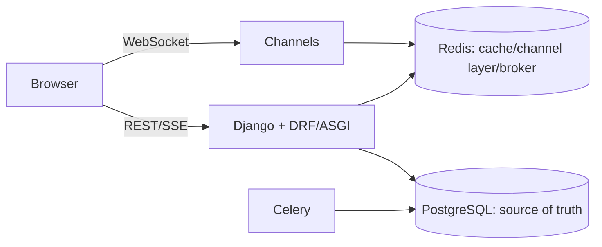

# CollabDesk.Django

A deliberately small, production-inspired support desk that uses Django 5.2, DRF, PostgreSQL, Redis, Channels, Celery, and SSE to demonstrate correctness under retries, concurrency, and worker failures. It is a portfolio application, not a security-certified production service.

## Run

```bash
cp .env.example .env
docker compose up --build -d --wait --wait-timeout 90
docker compose ps
# separately, create fictional local-only accounts (choose a non-production password):
docker compose exec api python manage.py seed_local_accounts --password local-demo-password
```

The browser demo is at `http://localhost:8000/`; the API documentation is at `http://localhost:8000/api/docs/`. Only the API joins the Compose edge network and publishes port 8000; PostgreSQL and Redis have no host ports and remain only on the private backend network. This keeps them distinct from any other Compose stack. PostgreSQL data is kept in the named `postgres_data` Compose volume, so `docker compose down` preserves it; never use `docker compose down -v` unless you intentionally want to remove local database data. Never use the illustrative Compose password outside local development.

## Browser demo

After running the seed command above, open `http://localhost:8000/` and use
one of the fictional accounts with the password supplied to the command:
`demo-customer`, `demo-agent`, or `demo-admin`.

The demo is deliberately served by Django on the same origin as the API. It
uses the session and CSRF protections already used by the API; no browser
token is stored or placed in a URL.

- As **demo-customer**, create a fictional ticket.
- In a separate browser profile, sign in as **demo-agent**, refresh, claim the
  open ticket, and open it. Open the same ticket as the customer to see the
  Django Channels conversation in both browser profiles. Each reconnect asks
  for message history after the last durable message id; received messages are
  acknowledged with read states.
- Select **Assistant** after selecting a ticket to start or cancel the bounded,
  deterministic local SSE stream.
- As **demo-admin**, select **Reports & cache** to request an asynchronous
  report, poll its status, and view ticket-cache hit/miss display.

The **Local test panel** is rendered only when `DJANGO_ENV` is
`development`, `dev`, `local`, or `test`. It makes ordinary
session-authenticated ticket calls to show idempotent ticket replay and the
single-winner claim race; it is not an endpoint and is absent from
production-like pages. The UI gives retry actions for ticket loading,
WebSocket reconnects, report polling, and stream/request errors.

Use `GET /api/health/live/` for a process liveness probe (it deliberately does not query dependencies), and `GET /api/health/ready/` for readiness. Readiness returns `200` only after PostgreSQL and Redis can both answer requests; otherwise it returns `503` with dependency status. `/api/health/` remains a liveness alias for compatibility.

The API container applies migrations before Daphne starts. The worker waits for API readiness, so it cannot begin consuming jobs before migrations and dependencies are available. Do not run `docker compose down -v` unless you intentionally want to remove local database data.

## Engineering evidence

- `POST /api/tickets` requires `Idempotency-Key`. `IdempotencyRecord` has a database uniqueness constraint scoped to user, operation, and key. The ticket, outbox event, and completed response are committed in one transaction. A different request fingerprint conflicts; completed calls replay the stored response. A transaction crash rolls all of it back, while a crash after commit replays safely. Records expire after 24 hours and can be removed with `python manage.py cleanup_idempotency_records`; schedule that command in deployment operations.
- `POST /api/tickets/{id}/claim` is a single conditional PostgreSQL `UPDATE`: only `open` and unassigned rows change. That is safe across web processes; without it, two read-then-write claimers could both report success.
- `POST /api/tickets/{id}/status` performs a conditional `claimed -> resolved` transition using the assigned agent's `expected_version`; stale or competing transitions receive a conflict.
- Ticket and message lists return `{results, next_cursor}` and use signed keyset cursors. Chat persists messages before broadcasting. `(ticket, client_message_id)` is unique, so browser retries are idempotent. Redis Channels distributes notifications but is not treated as durable delivery; clients fetch the message list with its returned cursor after reconnect (`after=<id>` remains compatible for existing clients). The WebSocket protocol uses authenticated message, typing, read, and history/sync events; a history response is ordered by ascending message id and includes results, next_cursor, has_more, limit, and after. Client errors are structured as a type, code, and detail.
- `POST /api/assistant/stream` emits framed SSE `token`, `complete`, and error events from a deterministic local simulator. It uses a bounded 32-chunk response; client disconnect closes the generator.
- `GET /api/tickets/stats` provides cache-aside ticket totals for the current authenticated user and, for agents, their own assignment totals. Keys are namespaced (`CACHE_NAMESPACE`) and versioned (`CACHE_VERSION`), have a configurable `TICKET_STATS_CACHE_TTL_SECONDS`, include the user id and role, and use a short Redis ownership lock to reduce concurrent cold-query fan-out. Ticket and message commits advance a generation key so old totals cannot be read. Redis failure or lock contention always falls back to PostgreSQL; neither cached statistics nor locks authorize users or enforce workflow correctness. Administrators can inspect best-effort `GET /api/tickets/cache-metrics` hit/miss counters.
- `ReportJob` and its `report.run` outbox event commit together. The periodic publisher and stale-job watchdog use database leases, heartbeats, bounded exponential backoff, and terminal attempt limits. Celery can deliver a task more than once (including after a publisher crash between broker acceptance and the database acknowledgement); token-guarded report completion makes the persisted result idempotent. The database result and UTC daily/monthly aggregate summaries commit before the optional Redis cache write. Results expire after `REPORT_RESULT_TTL_SECONDS`; expiration clears the durable output and cache, while `refresh: true` requests new work. This is deliberately at-least-once, not exactly-once delivery.
- Admins may create filtered reports with `start`, `end`, `statuses`, `agent_id`, and `granularity` (`day`/`month`), list report jobs through signed cursor pagination, and download a ready result from `GET /api/reports/{id}/download?format=json|csv`. First response time is measured only from ticket creation to the first message sent by its assigned agent; report buckets use UTC.



## Test

Validate the PostgreSQL baseline with the Compose services running:

```bash
docker compose exec api python manage.py check --database default
docker compose exec api python manage.py makemigrations --check --dry-run
docker compose exec api python manage.py migrate --check
docker compose exec api pytest -m postgres tests/test_core.py::test_parallel_claim_has_one_winner
docker compose exec api pytest
curl --fail http://localhost:8000/api/health/ready/
```

`POSTGRES_TEST_DB=test_collabdesk` is configured explicitly so pytest never uses the application database. The test runner creates and destroys that local PostgreSQL test database. To inspect the stack without deleting its volumes, use `docker compose stop` or `docker compose down` (without `-v`).

SQLite remains an opt-in local unit-test fallback only; PostgreSQL-only tests are intentionally skipped in this mode:

```bash
python -m venv .venv && .venv/bin/pip install -r requirements.txt
USE_SQLITE=1 DJANGO_ENV=test .venv/bin/pytest
```

The concurrency test must target Compose PostgreSQL: SQLite cannot demonstrate PostgreSQL locking/unique-index semantics. `tests/test_core.py` covers readiness/liveness behavior, replay, altered payload conflict, parallel claim, message de-duplication, and SSE framing. The Playwright workflow below covers browser, Channels, SSE cancellation, and Celery-backed report completion.

### Browser E2E (Playwright)

The reproducible browser workflow uses the fixed local Compose edge port
`127.0.0.1:8000`, three isolated Chromium contexts, and only the fictional
seeded accounts. It verifies customer ticket creation, agent authorization
rejection before claim, claim, live WebSocket chat, history after a browser
reconnect, SSE cancellation, and a completed administrator report. The E2E
test creates uniquely prefixed fictional records and leaves ordinary local
Compose data intact.

```bash
ASSISTANT_STREAM_TOKEN_DELAY_SECONDS=0.15 docker compose up --build -d --wait --wait-timeout 120
docker compose exec -T api python manage.py seed_local_accounts --password local-demo-password
npm ci
npx playwright install chromium  # omit when using a local Chrome executable below
E2E_BASE_URL=http://127.0.0.1:8000 npm run e2e
```

On systems with Google Chrome already installed, use it without downloading a
Playwright browser:

```bash
PLAYWRIGHT_CHROMIUM_EXECUTABLE=/usr/bin/google-chrome E2E_BASE_URL=http://127.0.0.1:8000 npm run e2e
```

The success screenshot is emitted only after completed report output is
visible and is retained beneath the ignored `test-results/` directory. CI runs
the same command in the `browser-e2e` job and uploads the Playwright report.

## Authentication and security

`POST /api/auth/login/` creates a Django session and rotates its identifier. Browser callers first use `GET /api/auth/csrf/`, then include the CSRF cookie/header for unsafe session-authenticated requests such as `POST /api/auth/logout/`. Session cookies are HttpOnly, SameSite=Lax, and Secure outside development; production must set `DJANGO_SECRET_KEY` and use TLS.

Non-browser clients may request `issue_token: true` at login and send the returned short-lived credential as `Authorization: Bearer <token>`. Only a SHA-256 digest is stored; `POST /api/auth/logout/` revokes the presented token. Bearer credentials are intentionally never accepted in a WebSocket URL. Browser WebSockets authenticate from the HttpOnly session cookie, reload that session before events so server-side logout/expiry takes effect, and require an exact allowed `Origin`.

Customer accounts create and access their tickets; agents list open/their assigned tickets, claim open tickets, and access only assigned conversations; application admins access all tickets. `role=admin` sets Django `is_staff`; only explicit Django superusers receive `is_superuser`. CORS, CSRF, and WebSocket origins are explicit environment allow-lists with no wildcard. Login attempts are limited per privacy-preserving address fingerprint.

`seed_local_accounts` only runs when `DJANGO_ENV` is `development`, `dev`, `local`, or `test`; it requires an explicit password and creates fictional `demo-customer`, `demo-agent`, and `demo-admin` accounts. It is disabled in production-like environments. There are no real credentials or external AI dependencies in this repository.

See [architecture notes](docs/architecture.md) for guarantees and recovery boundaries.

## API and OpenAPI

The generated contract is available at [`/api/schema/`](http://localhost:8000/api/schema/)
and the interactive local Swagger UI at [`/api/docs/`](http://localhost:8000/api/docs/).
The schema is generated from the running Django application, so it is the
authoritative endpoint reference for this demo. Save a local copy with:

```bash
curl --fail --silent http://127.0.0.1:8000/api/schema/ -o /tmp/collabdesk-openapi.yaml
```

The following is a fictional, non-browser token example. The token is
short-lived; do not paste a real credential into source, screenshots, or a
shell history you intend to share.

```bash
# The demo account exists only after the documented local seed command.
curl --fail --silent --show-error \
  -H 'Content-Type: application/json' \
  -d '{"username":"demo-customer","password":"local-demo-password","issue_token":true}' \
  http://127.0.0.1:8000/api/auth/login/

# Substitute the returned token only in your local shell.
curl --fail --silent --show-error \
  -H 'Authorization: Bearer <local-short-lived-token>' \
  -H 'Content-Type: application/json' \
  -H 'Idempotency-Key: local-example-ticket-001' \
  -d '{"title":"Fictional login problem","description":"Created only for a local API example."}' \
  http://127.0.0.1:8000/api/tickets
```

Browser callers use `GET /api/auth/csrf/` and the session/CSRF flow described
above, not a token copied into browser storage. Ticket creation is customer
only and requires a unique `Idempotency-Key`; a replay of the same payload/key
returns the originally stored response.

## Evidence and portfolio review

The links below connect each visible feature to executable coverage or a
recorded local artifact. They are evidence of local verification, not a claim
of production certification.

| Feature | Automated evidence |
| --- | --- |
| Login, session/CSRF flow, bearer expiry/revocation, role boundaries | [`tests/test_auth.py`](tests/test_auth.py) |
| Idempotent ticket creation, PostgreSQL claim race, durable messages, probes | [`tests/test_core.py`](tests/test_core.py), [`tests/test_ticket_hardening.py`](tests/test_ticket_hardening.py) |
| Channels history/read receipts and SSE bounds/cancellation | [`tests/test_chat_channels.py`](tests/test_chat_channels.py), [`tests/test_sse_streaming.py`](tests/test_sse_streaming.py) |
| At-least-once report processing, analytics, cache behavior | [`tests/test_report_jobs.py`](tests/test_report_jobs.py), [`tests/test_report_analytics.py`](tests/test_report_analytics.py), [`tests/test_ticket_cache_redis.py`](tests/test_ticket_cache_redis.py) |
| Browser workflow: ticket, chat, reconnect, SSE cancellation, completed report | [`tests/e2e/collabdesk.spec.js`](tests/e2e/collabdesk.spec.js) and [local run report](docs/task-reports/DJ-011.md) |
| Reporting benchmark (10k/50k/100k fictional PostgreSQL fixtures) | [benchmark report and raw JSON](docs/task-reports/DJ-012.md) |

The E2E scenario saves a real completed-report screenshot only after its UI
assertions pass. After running the documented E2E command, view the local
artifact at [`test-results/.../dj-011-completed-report.png`](test-results/collabdesk-customer-and-ag-2ba31-e-the-live-support-workflow/dj-011-completed-report.png).
It is intentionally ignored because it is generated evidence; the reproducible
command and inspection result are recorded in [DJ-011](docs/task-reports/DJ-011.md).

### Security threats and limitations

- Threats addressed in this demonstration include credentialed cross-origin
  requests (explicit CORS/CSRF origin lists), session theft exposure (HttpOnly,
  SameSite cookies and secure cookies outside debug), token persistence (only a
  digest is stored), ticket/message authorization, duplicate client retries,
  Redis loss, and duplicate worker delivery.
- This is not security-certified or production-ready. It has no external
  penetration test, formal threat-model review, security monitoring, backup or
  disaster-recovery exercise, accessibility audit, cross-browser matrix, or
  load test. The benchmark uses local Compose PostgreSQL and an isolated
  `LocMemCache`; it is not a Redis, cloud, or production capacity result.
- The 2026-10-24 dependency advisory review found known advisories in the
  constrained DRF, pytest, and transitive Twisted versions. No unreviewed
  major-version upgrade was made during this documentation gate; resolve and
  retest those advisories before any production use.
- Deployment operators must provide a unique `DJANGO_SECRET_KEY`, TLS, trusted
  host/origin configuration, secret management, retention/backup policies, and
  schedule the idempotency cleanup command. Do not use demo credentials or the
  example Compose password outside local development.

### Verified CV bullets

- Built and locally verified a Django support-desk portfolio application with
  idempotent ticket creation, role-scoped workflows, durable chat recovery,
  bounded SSE, and asynchronous reporting.
- Added reproducible Docker Compose, Django/pytest, and Playwright evidence
  using only fictional local accounts and data.
- Measured local PostgreSQL reporting behavior on deterministic 10k, 50k, and
  100k fictional-ticket fixtures; results and limitations are linked above.
