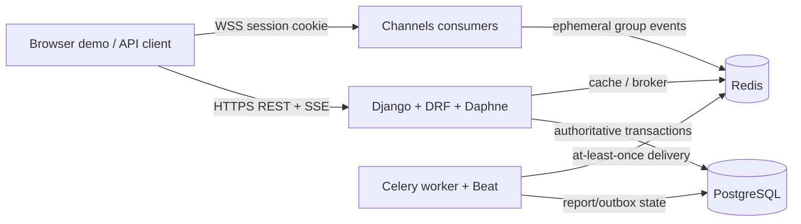

# Architecture decisions

## Runtime topology

Only the Django API publishes a local Compose port. PostgreSQL and Redis are
on the internal backend network; the browser never talks to either directly.
PostgreSQL is the source of truth. Redis supports cache, channel fan-out, and
broker delivery, but a Redis failure must not authorize a request or make a
committed ticket/report result inconsistent.

PostgreSQL is authoritative for users, tickets, messages, idempotency rows, outbox events, report jobs, and report results. Redis may disappear: that means a cache miss, delayed live notification, or delayed job delivery, never an inconsistent ticket or report result.

Chat follows the same boundary. A WebSocket notification is a live hint, not a
delivery record: messages and per-reader read receipts are committed in
PostgreSQL first. A reconnect sends the last durable message cursor in a
history or sync event and receives an ascending, bounded page with an opaque
ticket-bound continuation cursor. Socket membership is rechecked against the
current session and ticket participants for every client event and every
outbound group event, so logout, expiry, reassignment, and revocation affect
existing sockets as well as new handshakes.

The ticket creation transaction either commits the idempotency response and ticket together or neither. The small interval between a client losing its response and the commit is harmless: retry finds the completed idempotency row. A stale `processing` row should be expired by a maintenance task only after its maximum request duration; its associated business transaction has already rolled back on connection loss.

Celery delivery is at least once. Report creation commits `ReportJob` and a
`report.run` outbox event together; a periodic publisher leases due events and
only records `published` after Celery accepts the task. A publisher crash after
broker acceptance may therefore publish again, by design. Report workers lease
jobs with a token and heartbeat, persist a result only while they still own the
lease, and write the database result before the optional Redis cache. Failed
work is re-dispatched through a delayed outbox event with bounded exponential
backoff; the watchdog reclaims expired leases and eventually marks exhausted
jobs/events terminally failed. This is at-least-once delivery, not an
exactly-once claim; report computation is read-only and its persisted result is
idempotent.

Analytics reports group tickets in UTC with Django's `TruncDate`/`TruncMonth`,
not database-specific raw SQL. A first response is the first post-creation
conversation message from the assigned agent, so customer messages do not
artificially reduce response time. The report worker writes result output and
daily/monthly materialized aggregate rows in one database transaction, then
best-effort caches the completed output in Redis. Ticket/message commits
invalidate affected aggregate buckets; a scheduled refresh rebuilds recent
buckets. Result output has a bounded retention period and is cleared from both
PostgreSQL and Redis after expiry. Admin authorization is checked before every
report list, result, or download response.

## Recovery boundaries and non-goals

- WebSocket events and Redis cache values are hints, not durable records. The
  PostgreSQL message log, cursors, and report state are the recovery path.
- Celery transport is deliberately at-least-once, not exactly-once. Lease and
  token checks make report result persistence idempotent, but callers must
  tolerate duplicate delivery attempts.
- The local Compose topology and fictional seed data are review tooling, not a
  deployment design. TLS termination, backups, observability, secret rotation,
  capacity planning, and disaster recovery remain operator responsibilities.
